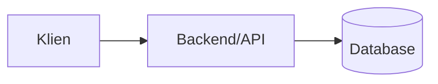

# Arsitektur - <Nama Projek>

## Gambaran besar
<Apa yang dilakukan sistem, aktor utama.>

## Komponen & tanggung jawab
| Komponen | Lokasi | Tugas | Bukan tugasnya |
|---|---|---|---|

## Aliran data utama
1. **<Alur 1>**: A -> B -> C (catat titik kegagalan)
2. **<Alur 2>**: ...

## Keputusan arsitektur
| Keputusan | Alasan | Alternatif yang ditolak |
|---|---|---|

## Dependensi eksternal
| Layanan | Dipakai untuk | Kuota/biaya | Jika gagal |
|---|---|---|---|

## Invarian & aturan lintas-modul
- <mis. semua tulis DB lewat Service>

## Batas yang diketahui & utang teknis
- <...>
