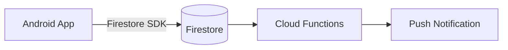

# Dokumen panduan AI lainnya

Daftar isi: [Peta file per tool](#peta-file-per-tool) · [CLAUDE.md](#claudemd) · [GEMINI.md](#geminimd) · [Cursor rules](#cursor-rules) · [Copilot](#github-copilot) · [ARCHITECTURE.md](#architecturemd) · [TESTING.md](#testingmd) · [DATABASE.md](#databasemd) · [API.md](#apimd) · [SECURITY.md](#securitymd) · [DEPLOYMENT.md](#deploymentmd) · [CONTRIBUTING.md](#contributingmd) · [Prompt/Playbook](#playbook-tugas-berulang) · [Struktur docs/](#struktur-docs-yang-disarankan)

## Peta file per tool

| Tool | File yang dibaca | Strategi |
|---|---|---|
| Codex, Jules, Copilot coding agent, Cursor, Gemini CLI (via konfigurasi), Windsurf, Aider (via konfigurasi) | `AGENTS.md` | Sumber utama |
| Claude Code | `CLAUDE.md` (mendukung `@path` import), `.claude/` (settings, commands, skills) | `CLAUDE.md` berisi `@AGENTS.md` |
| Gemini CLI | `GEMINI.md` (bisa dikonfigurasi membaca `AGENTS.md`) | Pointer ke AGENTS.md |
| Cursor | `.cursor/rules/*.mdc` (juga membaca AGENTS.md) | Aturan per-glob yang spesifik |
| GitHub Copilot | `.github/copilot-instructions.md`, `.github/instructions/*.instructions.md` | Ringkas + pointer |
| Windsurf | `.windsurf/rules/` | Pointer |
| Cline / Roo | `.clinerules` | Pointer |

Aturan: **isi substansial hanya di AGENTS.md**; file tool lain berisi pointer 3-10 baris plus hal yang benar-benar khusus tool itu. Format file tool dapat berubah; jika tidak yakin, cek dokumentasi resmi tool tersebut sebelum menyebut sintaks yang spesifik.

## CLAUDE.md

Pola paling aman (lihat `assets/templates/CLAUDE.pointer.md`):
```markdown
@AGENTS.md

## Khusus Claude Code
- Gunakan plan mode untuk perubahan yang menyentuh >3 file atau skema DB.
- Sebelum menyatakan selesai, jalankan perintah verifikasi di AGENTS.md dan laporkan hasilnya.
```
Isi tambahan yang pantas: perilaku workflow khusus Claude (kapan plan mode, pemakaian subagent/slash command di `.claude/commands/`), izin tool yang diharapkan, dan MCP server yang tersedia. Jangan menyalin isi AGENTS.md.

## GEMINI.md

```markdown
# Panduan untuk Gemini
Baca dan ikuti `AGENTS.md` di root repo sebagai sumber utama konvensi dan perintah.
## Catatan khusus
- (hanya bila ada perilaku yang berbeda untuk Gemini)
```

## Cursor rules

Format: `.cursor/rules/<nama>.mdc` dengan frontmatter.
```markdown
---
description: Aturan komponen React (dipakai saat mengedit komponen UI)
globs: ["src/components/**/*.tsx"]
alwaysApply: false
---
- Komponen fungsi + hooks; props diketik dengan `type Props`.
- Gunakan komponen dari `src/components/ui`; lihat DESIGN.md bagian Komponen.
```
Panduan: satu aturan per topik/area, `alwaysApply: true` hanya untuk yang benar-benar universal dan pendek, gunakan `globs` agar aturan dimuat hanya saat relevan, rujuk file contoh dengan path. (File `.cursorrules` lama di root bersifat usang; migrasikan.)

## GitHub Copilot

`.github/copilot-instructions.md`: ringkas (< 1-2 halaman). Isi: bahasa/stack, perintah build-test, konvensi paling penting, pointer ke AGENTS.md. Untuk aturan per-folder gunakan `.github/instructions/<nama>.instructions.md` dengan frontmatter `applyTo: "src/**/*.ts"`. Untuk Copilot coding agent, `.github/workflows/copilot-setup-steps.yml` dapat menyiapkan lingkungan (install dependency) agar agent bisa menjalankan test.

## ARCHITECTURE.md

Tujuan: model mental sistem dalam 5-10 menit baca. Agent memakainya untuk memutuskan *di mana* sebuah perubahan seharusnya dibuat.

Struktur:
1. **Gambaran besar** - apa yang dilakukan sistem, aktor utama, 1 diagram (Mermaid/ASCII).
2. **Komponen & tanggung jawab** - tiap modul/service: tugas, batas, apa yang *tidak* ia lakukan.
3. **Aliran data** - 2-3 alur utama ujung-ke-ujung (mis. "kirim pesan", "submit ujian").
4. **Keputusan arsitektur** - pilihan penting + alasan + alternatif yang ditolak (gaya ADR singkat).
5. **Dependensi eksternal** - layanan pihak ketiga, kuota/biaya, mode kegagalan.
6. **Invarian & aturan lintas-modul** - mis. "semua tulis ke DB lewat Service; controller tidak boleh query".
7. **Skalabilitas & batas yang diketahui** - hotspot, utang teknis.

Diagram contoh (Mermaid):

Tulis "mengapa", bukan hanya "apa"; yang pertama tidak bisa dibaca dari kode.

## TESTING.md

- Piramida test yang dipakai (unit/integrasi/e2e) dan proporsinya
- Cara menjalankan: semua, satu file, satu test, watch mode, coverage
- Lingkungan: DB test (sqlite in-memory vs MySQL), emulator, fixture/factory, seed
- Aturan mock: apa yang di-mock (jaringan, waktu, pembayaran) dan apa yang tidak (DB internal)
- Konvensi penamaan & struktur (Arrange-Act-Assert), snapshot (kapan boleh)
- Flaky test: cara menangani, kebijakan retry
- Ekspektasi PR: bug fix wajib test regresi; fitur baru wajib test jalur utama dan satu kasus gagal
- Ambang coverage bila ada, dan tempat konfigurasinya

## DATABASE.md

- Mesin DB, versi, cara menjalankan lokal, cara reset
- Peta entitas inti (ERD ringkas atau daftar tabel/koleksi + relasi)
- Konvensi: penamaan, PK/UUID, soft delete, timestamp & zona waktu, enum
- Aturan migrasi: tidak boleh mengedit yang sudah ter-merge, reversible, besar tabel & lock
- Indeks & performa: query yang sensitif, N+1 yang diketahui
- Untuk Firestore/NoSQL: struktur koleksi, aturan denormalisasi, aturan keamanan, batas dokumen/tulis, biaya baca
- Data sensitif/PII: kolom mana, enkripsi, retensi

## API.md

- Base URL per lingkungan (tanpa secret), skema autentikasi
- Konvensi: versi, penamaan resource, format error standar, paginasi, idempotensi, rate limit
- Daftar endpoint inti dengan contoh request/response (atau tautkan OpenAPI)
- Cara menambah endpoint: lokasi route, validasi, resource/transformer, test
- Kebijakan breaking change

## SECURITY.md

Dua bagian: (1) kebijakan pelaporan kerentanan untuk manusia; (2) aturan keamanan untuk agent/pengembang.
- Secret: lewat env var/secret manager; tidak pernah di repo; contoh `.env.example`
- AuthN/AuthZ: di mana dicek, pola otorisasi (Policy/Gate, Firestore rules, middleware)
- Validasi input & output encoding; larangan query string-concat; upload file (tipe/ukuran/penyimpanan)
- Data anak/pengguna sensitif: apa yang boleh disimpan/dicatat di log
- Dependensi: kebijakan menambah paket, audit rutin (`npm audit`, `composer audit`)
- Area yang butuh review keamanan manusia (auth, pembayaran, enkripsi)

## DEPLOYMENT.md

- Lingkungan (local/staging/prod), URL dan cara akses (tanpa secret)
- Langkah deploy per target (cPanel/VPS aaPanel/Cloud Run/Firebase Hosting), termasuk build artefak, migrasi, cache clear, worker/queue/cron
- Rollback: perintah dan batas waktu
- Konfigurasi & env var yang wajib (nama, bukan nilai)
- Pemeriksaan pasca-deploy (smoke test, health endpoint, log yang dipantau)
- Siapa yang boleh deploy; agent **tidak** boleh deploy ke produksi tanpa instruksi eksplisit (tulis di Boundaries)

## CONTRIBUTING.md

Untuk manusia, juga berguna bagi agent: cara setup, alur branch/PR, format commit, standar review, definisi "selesai", cara melapor bug. Jika AGENTS.md sudah memuat alur Git, cukup tautkan.

## Playbook tugas berulang

Untuk tugas yang sering diminta ke agent, simpan resep di `docs/playbooks/` (atau `.claude/commands/`, `.cursor/rules`) dan tautkan dari AGENTS.md. Contoh judul: `add-endpoint.md`, `add-migration.md`, `add-screen-compose.md`, `release-android.md`.

Format playbook:
```markdown
# Menambah endpoint API
Gunakan saat: membuat endpoint REST baru.
Langkah:
1. Route di `routes/api.php` (grup `v1`)
2. Form Request di `app/Http/Requests/` (contoh: StorePostRequest)
3. Controller tipis -> panggil Service di `app/Services/`
4. API Resource di `app/Http/Resources/`
5. Test fitur di `tests/Feature/Api/` (kasus sukses, validasi gagal, tidak berwenang)
Selesai bila: `composer test` hijau dan endpoint tercatat di API.md.
```

## Struktur docs/ yang disarankan

```
AGENTS.md                  # utama
CLAUDE.md                  # @AGENTS.md + catatan Claude
GEMINI.md                  # pointer
DESIGN.md                  # bahasa visual (jika ada UI)
docs/
  ARCHITECTURE.md
  TESTING.md
  DATABASE.md
  API.md
  SECURITY.md
  DEPLOYMENT.md
  adr/0001-pilih-firestore.md
  playbooks/add-endpoint.md
.cursor/rules/*.mdc        # aturan per-glob
.github/copilot-instructions.md
```
Letakkan dokumen yang sering dibaca (AGENTS, DESIGN) di root, yang lebih dalam di `docs/`. Tautkan semuanya dari AGENTS.md dengan "baca saat...".
