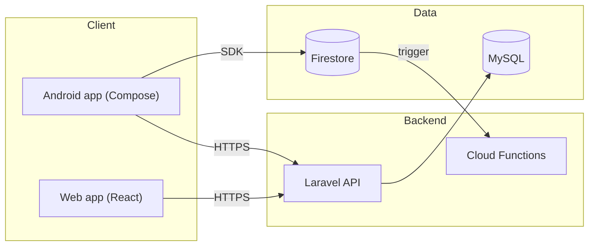
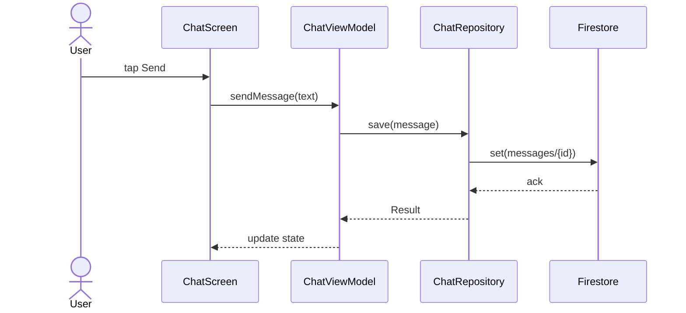
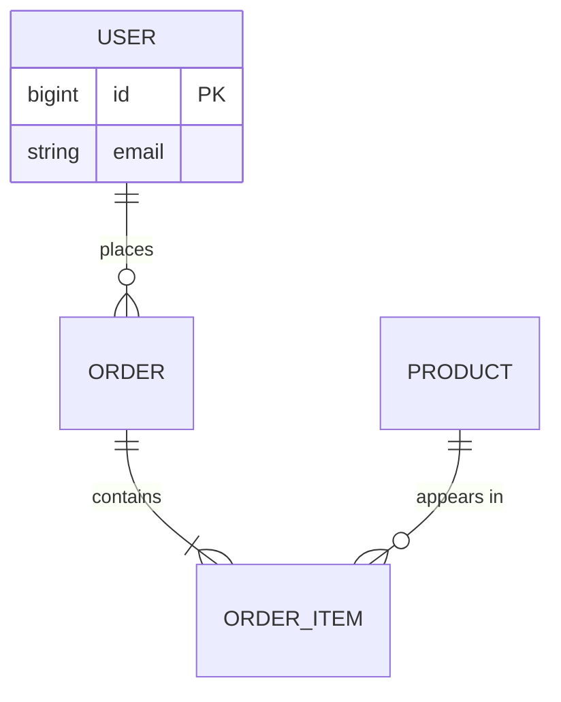
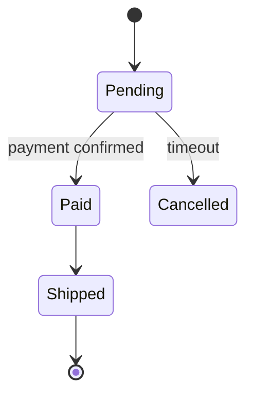
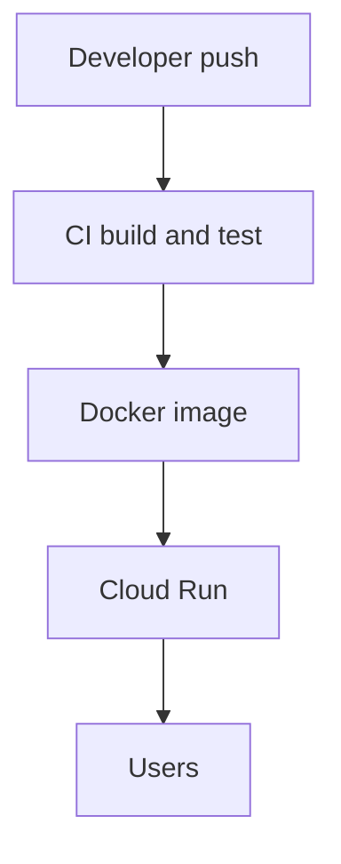

# Mermaid diagram patterns

Use Mermaid in fenced blocks (```mermaid). GitHub, GitLab and most Markdown viewers render it. Keep diagrams small (under ~15 nodes), label edges with verbs, and quote labels that contain spaces or punctuation. Name real components from the code, not generic boxes.

## Architecture (flowchart)



## Request or user flow (sequence)



Use `alt`/`opt` blocks for error paths when they matter:

```
alt offline
  R->>R: queue locally
else online
  R->>FS: set()
end
```

## Data model (ER)



## Status lifecycle (state)



## Deployment



## Folder or module dependencies

Use a flowchart with `-->` meaning "depends on". Show only layers that matter and flag any violation of the intended direction.

## Pitfalls
- Avoid parentheses, colons or slashes in unquoted labels. Quote them: `A["POST /api/orders"]`.
- Do not use more than one diagram per idea. If two diagrams overlap, keep the clearer one.
- If you cannot confirm a relationship from code, leave it out rather than guess.
